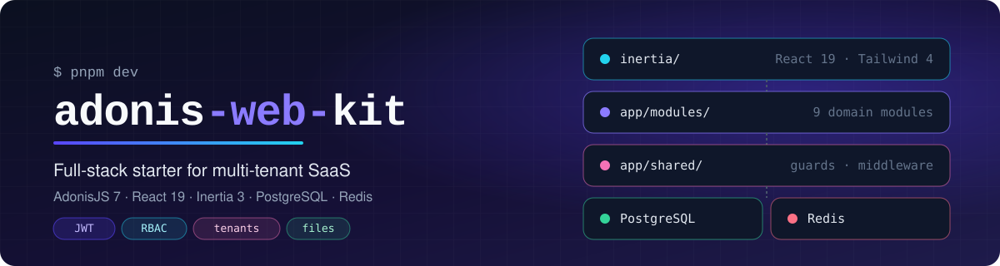
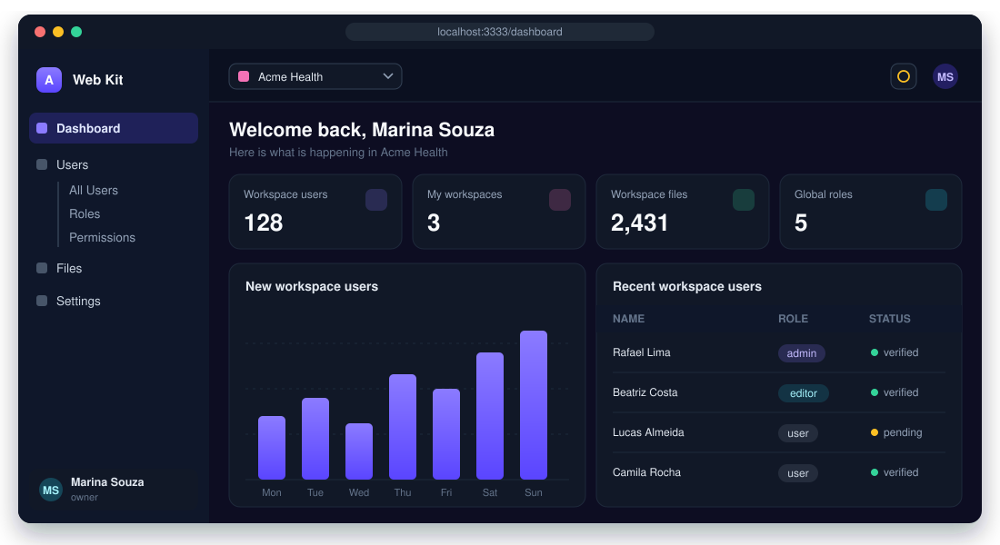
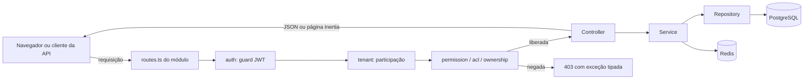

<div align="center">



<p>
  <a href="https://nodejs.org/"></a>
  <a href="https://adonisjs.com/"></a>
  <a href="https://react.dev/"></a>
  <a href="https://inertiajs.com/"></a>
  <a href="https://www.typescriptlang.org/"></a>
  <a href="https://tailwindcss.com/"></a>
  <a href="https://github.com/gabrielmaialva33/adonis-web-kit/actions/workflows/ci-cd.yml"></a>
  <a href="package.json"></a>
  <a href="LICENSE"></a>
</p>

[English](README.md) · **Português**

---

_"Auth, tenants, permissões e arquivos já estão prontos. Vai construir o produto."_



</div>

---

> [!IMPORTANT]
> **`adonis-web-kit` é um starter full-stack opinativo para SaaS e aplicações multi-tenant.**
> Um backend **AdonisJS 7** organizado em módulos de domínio, um frontend **React 19 + Inertia 3** no mesmo
> repositório e as partes que todo produto reescreve já ligadas: JWT de vida curta com refresh token rotativo,
> workspaces N:N, controle de acesso por papéis com herança, checagem de dono, armazenamento de arquivos em cinco
> drivers e um painel administrativo. Está em **pré-1.0** (`0.9.0`): mudança de schema ainda entra na migration
> `create_*` original.

---

## Visão geral

O backend roda TypeScript direto pelo `@poppinss/ts-exec`, o frontend é uma SPA servida pelo Inertia, e os dois
dividem um `package.json`, um type checker e um pipeline de CI.

<table>
  <tr>
    <td width="33%" valign="top"><h3>🔐 Ciclo de conta completo</h3>JWT de acesso (15 min na API, 1 h na web), refresh token opaco rotativo guardado como HMAC, verificação de e-mail, recuperação de senha, tokens de API e exclusão da própria conta.</td>
    <td width="33%" valign="top"><h3>🏢 Multi-tenancy N:N</h3>Usuários pertencem a vários workspaces pelo <code>user_tenants</code>; o ativo vai no JWT verificado e toda requisição confere a participação.</td>
    <td width="33%" valign="top"><h3>👥 RBAC com herança</h3>Papéis e permissões globais, permissões diretas e temporárias por usuário, herança entre papéis, checagem de dono e cache de permissões no Redis.</td>
  </tr>
  <tr>
    <td valign="top"><h3>📁 Arquivos em cinco drivers</h3>Upload, listagem e exclusão por dono dentro do workspace, em disco local, S3, DigitalOcean Spaces, Cloudflare R2 ou Google Cloud Storage.</td>
    <td valign="top"><h3>🎨 79 componentes de UI</h3>Biblioteca Metronic (estilo shadcn) sobre Radix UI e Tailwind 4, com painel de sidebar, seletor de workspace e troca de tema.</td>
    <td valign="top"><h3>🧪 Testado de ponta a ponta</h3>Suítes Japa de unidade, funcionais e de navegador (Playwright) contra PostgreSQL e Redis reais, Vitest no frontend e asserções de OpenAPI.</td>
  </tr>
</table>

| Propriedade           | Valor                                                                                                   |
| :-------------------- | :------------------------------------------------------------------------------------------------------ |
| **Pacote**            | `adonis-web-kit` `0.9.0`, MIT                                                                           |
| **Runtime**           | Node.js 24 LTS (`.nvmrc`), pnpm 11 (`packageManager`)                                                   |
| **Backend**           | AdonisJS 7, Lucid ORM, VineJS, Bull Queue                                                               |
| **Frontend**          | React 19, Inertia 3, Tailwind CSS 4, TanStack Table e Query, React Hook Form + Zod                      |
| **Dados**             | PostgreSQL (SQLite disponível para testes) e Redis (cache, sessões, rate limit, fila)                   |
| **Referência da API** | Redoc em `/docs`, spec OpenAPI em `/docs/openapi.yaml`, requisições em [`docs/api.http`](docs/api.http) |
| **Regras de agente**  | [`CLAUDE.md`](CLAUDE.md) e [`AGENTS.md`](AGENTS.md)                                                     |

### Como uma requisição flui



Cada guarda é um middleware nomeado de `app/shared/middleware/`. Controllers ficam enxutos: regra de negócio mora nos
services, consulta nos repositories, e todo repository de dado do workspace filtra por `ctx.tenant.id`.

## Começo rápido

```bash
# 1. Clonar e instalar (Node.js 24 LTS e pnpm 11)
git clone https://github.com/gabrielmaialva33/adonis-web-kit.git && cd adonis-web-kit
pnpm install
# 2. Ambiente e chave da aplicação
cp .env.example .env && pnpm ace generate:key
# 3. PostgreSQL, Redis e a caixa de e-mail do Mailpit
docker compose up -d postgres redis mailpit
# 4. Schema e dados de desenvolvimento, depois o servidor com HMR
pnpm ace migration:run && pnpm ace db:seed
pnpm dev
```

A aplicação responde em `http://localhost:3333` e o Mailpit mostra os e-mails enviados em `http://localhost:8025`. Já
tem PostgreSQL ou Redis rodando em outro lugar? Pule os dois no passo 3 e aponte o `.env` para os seus.

> [!NOTE]
> Não existe `node ace` no AdonisJS 7: o ace precisa do loader de TypeScript, então todo comando passa por
> `pnpm ace <comando>`.

> [!WARNING]
> Até a `1.0`, as migrations descrevem uma instalação limpa. Mudança de schema entra na migration `create_*` original e
> você recria os bancos de desenvolvimento e teste; não empilhe migrations de `alter` para um schema que nunca foi
> publicado.

## Arquitetura

O backend é organizado **por domínio**, não por camada técnica. Cada módulo cuida da sua fatia de ponta a ponta e
registra o próprio `routes.ts`:

| Módulo        | Cuida de                                                                      | Caminho base                     |
| :------------ | :---------------------------------------------------------------------------- | :------------------------------- |
| `auth`        | Login, cadastro, refresh, logout, recuperação de senha, verificação de e-mail | `/api/v1/sessions`, `/api/v1/me` |
| `users`       | CRUD de usuários com exclusão lógica (`is_deleted`)                           | `/api/v1/users`                  |
| `roles`       | Listagem e atribuição de papéis                                               | `/api/v1/admin/roles`            |
| `permissions` | Catálogo de permissões, concessões por papel e usuário, herança, cache        | `/api/v1/admin`                  |
| `tenants`     | Workspaces, participação e troca                                              | `/api/v1/tenants`                |
| `files`       | Upload, listagem e exclusão dentro do workspace ativo                         | `/api/v1/files`                  |
| `audits`      | Log de auditoria das requisições que alteram dados                            | —                                |
| `health`      | Checagens de prontidão                                                        | `/api/v1/health`                 |
| `web`         | Páginas Inertia: auth, dashboard, usuários, papéis, arquivos, configurações   | `/`                              |

O código transversal fica em `app/shared/` (o guard JWT próprio, os middlewares, o repository base do Lucid e o
serviço de ownership) e as exceções tipadas em `app/exceptions/`. Os imports usam os aliases do pacote `#modules/*`,
`#shared/*`, `#exceptions/*`, `#config/*`, `#start/*`, `#database/*` e `#tests/*`, nunca caminhos relativos `../../`.

> [!TIP]
> `pnpm ace make:*` grava no layout padrão do AdonisJS (`app/controllers`, `app/models`…). Mova o arquivo gerado para
> `app/modules/<domínio>/` e corrija os imports, ou copie o formato de um módulo vizinho como `users`.

## Auth, workspaces e permissões

| Peça                    | Como funciona                                                                                                                              |
| :---------------------- | :----------------------------------------------------------------------------------------------------------------------------------------- |
| **Guards**              | `jwt` (padrão; cookie ou header `Authorization`), `api` (tokens de acesso), `web` (sessão) e `basicAuth`                                   |
| **Tokens**              | JWT de acesso com checagem de issuer, audience e tipo; refresh token opaco rotacionado em transação com lock, validade de 3 dias           |
| **Workspace ativo**     | Vem do header `x-tenant-id`, depois do claim `tenantId` do JWT, depois do primeiro workspace do usuário; a participação é sempre conferida |
| **Papéis no workspace** | `owner`, `admin`, `member` no pivot `user_tenants`                                                                                         |
| **Papéis globais**      | `root`, `admin`, `editor`, `user`, `guest`, com herança de permissões entre papéis                                                         |
| **Checagens**           | Middlewares `permission` (ex.: `files.delete` ou `files.delete.own`), `acl` (slugs de papel) e `ownership`                                 |

Papéis, permissões e logs de auditoria são **globais**; dado de workspace declara um `tenant_id` não nulo. O cadastro
pode criar um workspace pessoal (`REGISTRATION_WORKSPACE_MODE=personal`) ou deixar o onboarding para o produto
(`none`).

## Configuração

Identidade do produto e onboarding ficam em variáveis de ambiente; o [`start/env.ts`](start/env.ts) valida todas na
partida.

| Variável                                             | Para quê                                                |
| :--------------------------------------------------- | :------------------------------------------------------ |
| `APP_NAME`, `APP_URL`, `APP_SOURCE_URL`              | Marca, links gerados e o link opcional do código-fonte  |
| `APP_KEY`                                            | Chave de criptografia; gere com `pnpm ace generate:key` |
| `ACCESS_TOKEN_SECRET`, `REFRESH_TOKEN_SECRET`        | Segredos independentes dos tokens                       |
| `EMAIL_VERIFICATION_SECRET`, `PASSWORD_RESET_SECRET` | Segredos HMAC dos links de uso único                    |
| `JWT_ISSUER`, `JWT_AUDIENCE`, `JWT_COOKIE_NAME`      | Identidade do JWT e cookie da web                       |
| `REGISTRATION_WORKSPACE_MODE`                        | `personal` ou `none`                                    |
| `DEMO_PAGES_ENABLED`                                 | Páginas de referência dos componentes e do data grid    |
| `DRIVE_DISK`                                         | `fs`, `s3`, `spaces`, `r2` ou `gcs`                     |
| `DB_*`, `REDIS_*`, `QUEUE_REDIS_*`                   | Conexões do PostgreSQL, do Redis e da fila              |
| `MAIL_MAILER`, `SMTP_*`, `MAILGUN_*`                 | Envio de e-mail                                         |

> [!CAUTION]
> Os valores padrão de desenvolvimento e os placeholders do `docker-compose.yml` não são segredos. Em produção, gere
> valores longos e independentes para cada segredo e mantenha todos fora do controle de versão.

## Comandos

```bash
pnpm dev              # servidor de desenvolvimento com HMR
pnpm build            # build de produção (tsc do TS 7 + Vite)
pnpm start            # servidor de produção: node bin/server.js
pnpm ace <comando>    # qualquer comando do ace, ex.: migration:fresh, db:seed, repl
```

| Script                    | O que faz                                                  |
| :------------------------ | :--------------------------------------------------------- |
| `pnpm test`               | Suíte de unidade do backend (Japa)                         |
| `pnpm test:e2e`           | Todas as suítes do backend: unidade, funcional e navegador |
| `pnpm test:ui` / `:watch` | Testes do frontend (Vitest), uma vez ou em watch           |
| `pnpm typecheck`          | Type check do backend **e** do `inertia/`                  |
| `pnpm lint` / `lint:fix`  | ESLint, relatório ou correção                              |
| `pnpm format`             | Prettier                                                   |
| `pnpm docker`             | Migra, popula e sobe: o fluxo de entrada do container      |

> [!NOTE]
> **Dois TypeScripts, de propósito.** `typescript` aponta para `@typescript/typescript6` porque o `typescript-eslint`
> ainda não suporta a API do TS 7 ([#10940](https://github.com/typescript-eslint/typescript-eslint/issues/10940)) e
> resolve o TypeScript por peer dependency. O TS 7 entra como `typescript-native` e fica com o binário `tsc` usado por
> `pnpm typecheck` e `pnpm build`. Os dois voltam a ser uma entrada só quando o typescript-eslint alcançar.

## Testes

| Suíte          | Onde                            | Runner                                       | Timeout |
| :------------- | :------------------------------ | :------------------------------------------- | :------ |
| **unit**       | `tests/unit/**/*.spec.ts`       | Japa                                         | 2 s     |
| **functional** | `tests/functional/**/*.spec.ts` | Japa + cliente de API + asserções de OpenAPI | 30 s    |
| **browser**    | `tests/browser/**/*.spec.ts`    | Japa + Playwright                            | 60 s    |
| **frontend**   | `inertia/**/*.test.{ts,tsx}`    | Vitest + Testing Library + MSW               | —       |

As suítes do backend precisam de PostgreSQL e Redis e **zeram os dois**: o bootstrap roda migrations e seeders e limpa
o Redis. Aponte o `.env.test` para instâncias descartáveis, nunca para um banco que importa.

## Docker e CI

```bash
docker compose up -d postgres redis mailpit   # só a infraestrutura, app no host com pnpm dev
docker compose up --build                     # stack completa: app, PostgreSQL, Redis e Mailpit
```

O `Dockerfile` multi-stage tem um alvo `production`. Na stack completa, o container da aplicação espera as
dependências, roda as migrations pendentes e serve na porta `3333` (pare um `pnpm dev` do host antes). O Compose vem
com segredos de exemplo; exporte uma chave real antes de usar fora de um ambiente descartável:

```bash
export APP_KEY=$(pnpm ace generate:key --show | cut -d' ' -f3)
```

Todo push para `master` ou `develop` e todo pull request para `master` roda o [workflow de CI](.github/workflows/ci-cd.yml):
lint, type check, todas as suítes do backend no Chromium do Playwright, os testes do frontend e um build de produção,
contra containers de serviço de PostgreSQL e Redis.

## Contribuição

Leia o [guia de contribuição](CONTRIBUTING.md), o [Código de Conduta](CODE_OF_CONDUCT.md) e a [política de segurança](SECURITY.md).

```bash
git checkout -b feature/sua-feature
pnpm lint && pnpm typecheck
pnpm test:e2e && pnpm test:ui
```

Mantenha o layout modular, o fluxo por módulo (controller → service → repository → model, com `@inject()`) e os
aliases acima. As regras para agentes de código, e o porquê delas, estão no [`CLAUDE.md`](CLAUDE.md) e no
[`AGENTS.md`](AGENTS.md).

## Licença

MIT: veja o [`LICENSE`](LICENSE).

---

<div align="center">

**adonis-web-kit · Gabriel Maia · 2026**

_Feito sobre AdonisJS, para produtos que crescem um workspace de cada vez._


</div>
