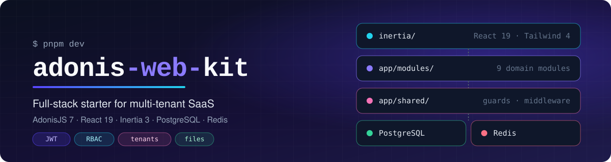
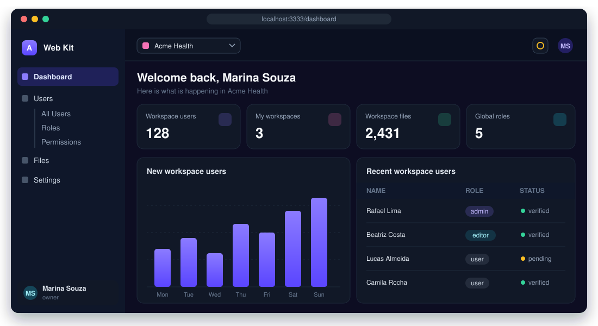
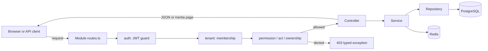

<div align="center">



<p>
  <a href="https://nodejs.org/"></a>
  <a href="https://adonisjs.com/"></a>
  <a href="https://react.dev/"></a>
  <a href="https://inertiajs.com/"></a>
  <a href="https://www.typescriptlang.org/"></a>
  <a href="https://tailwindcss.com/"></a>
  <a href="https://github.com/gabrielmaialva33/adonis-web-kit/actions/workflows/ci-cd.yml"></a>
  <a href="package.json"></a>
  <a href="LICENSE"></a>
</p>

**English** · [Português](README-pt.md)

---

_"Auth, tenants, permissions and files are done. Go build the product."_



</div>

---

> [!IMPORTANT]
> **`adonis-web-kit` is an opinionated full-stack starter for SaaS and multi-tenant applications.**
> An **AdonisJS 7** backend organized by domain modules, a **React 19 + Inertia 3** frontend in the same repository,
> and the parts every product rewrites already wired: short-lived JWTs with rotating refresh tokens, N:N workspaces,
> role-based access control with inheritance, ownership checks, file storage on five drivers and an admin shell.
> It is **pre-1.0** (`0.9.0`): schema changes still go into the original `create_*` migrations.

---

## Overview

The backend runs TypeScript directly through `@poppinss/ts-exec`, the frontend is a single-page app served by
Inertia, and both share one `package.json`, one type checker and one CI pipeline.

<table>
  <tr>
    <td width="33%" valign="top"><h3>🔐 Full account lifecycle</h3>Access JWTs (15 min on the API, 1 h on the web), rotating opaque refresh tokens stored as HMACs, email verification, password reset, API tokens and self-deletion.</td>
    <td width="33%" valign="top"><h3>🏢 N:N multi-tenancy</h3>Users belong to many workspaces through <code>user_tenants</code>; the active one rides in the verified JWT and every request checks membership.</td>
    <td width="33%" valign="top"><h3>👥 RBAC with inheritance</h3>Global roles, permissions, direct user grants, temporary permissions, role inheritance, ownership checks and a Redis permission cache.</td>
  </tr>
  <tr>
    <td valign="top"><h3>📁 Files on five drivers</h3>Workspace-scoped upload, listing and owner-aware deletion on local disk, S3, DigitalOcean Spaces, Cloudflare R2 or Google Cloud Storage.</td>
    <td valign="top"><h3>🎨 79 UI components</h3>A Metronic (shadcn-style) library on Radix UI and Tailwind 4, plus an admin shell with sidebar, workspace switcher and theme toggle.</td>
    <td valign="top"><h3>🧪 Tested end to end</h3>Japa unit, functional and Playwright browser suites against real PostgreSQL and Redis, Vitest for the frontend, OpenAPI assertions.</td>
  </tr>
</table>

| Property          | Value                                                                                                |
| :---------------- | :--------------------------------------------------------------------------------------------------- |
| **Package**       | `adonis-web-kit` `0.9.0`, MIT                                                                        |
| **Runtime**       | Node.js 24 LTS (`.nvmrc`), pnpm 11 (`packageManager`)                                                |
| **Backend**       | AdonisJS 7, Lucid ORM, VineJS, Bull Queue                                                            |
| **Frontend**      | React 19, Inertia 3, Tailwind CSS 4, TanStack Table and Query, React Hook Form + Zod                 |
| **Data**          | PostgreSQL (SQLite available for tests) and Redis (cache, sessions, rate limits, queue)              |
| **API reference** | Redoc at `/docs`, OpenAPI spec at `/docs/openapi.yaml`, requests in [`docs/api.http`](docs/api.http) |
| **Agent rules**   | [`CLAUDE.md`](CLAUDE.md) and [`AGENTS.md`](AGENTS.md)                                                |

### How a request flows



Each guard is a named middleware from `app/shared/middleware/`. Controllers stay thin: business rules live in services,
queries in repositories, and every tenant-scoped repository filters by `ctx.tenant.id`.

## Quick start

```bash
# 1. Clone and install (Node.js 24 LTS and pnpm 11)
git clone https://github.com/gabrielmaialva33/adonis-web-kit.git && cd adonis-web-kit
pnpm install
# 2. Environment and application key
cp .env.example .env && pnpm ace generate:key
# 3. PostgreSQL, Redis and the Mailpit inbox
docker compose up -d postgres redis mailpit
# 4. Schema and development data, then the dev server with HMR
pnpm ace migration:run && pnpm ace db:seed
pnpm dev
```

The app answers on `http://localhost:3333` and Mailpit shows outgoing email on `http://localhost:8025`. Already running
PostgreSQL or Redis elsewhere? Skip them in step 3 and point `.env` at yours.

> [!NOTE]
> There is no `node ace` in AdonisJS 7: ace needs the TypeScript loader, so every command goes through
> `pnpm ace <command>`.

> [!WARNING]
> Until `1.0`, migrations describe a clean install. A schema change goes into its original `create_*` migration and
> you recreate the dev and test databases; do not stack `alter` migrations for a schema that never shipped.

## Architecture

The backend is organized **by domain**, not by technical layer. Each module owns its slice end to end and registers its
own `routes.ts`:

| Module        | Owns                                                                  | Base path                        |
| :------------ | :-------------------------------------------------------------------- | :------------------------------- |
| `auth`        | Sign-in, sign-up, refresh, logout, password reset, email verification | `/api/v1/sessions`, `/api/v1/me` |
| `users`       | User CRUD with soft delete (`is_deleted`)                             | `/api/v1/users`                  |
| `roles`       | Role listing and assignment                                           | `/api/v1/admin/roles`            |
| `permissions` | Permission catalog, role and user grants, inheritance, cache          | `/api/v1/admin`                  |
| `tenants`     | Workspaces, membership and switching                                  | `/api/v1/tenants`                |
| `files`       | Upload, listing and deletion inside the active workspace              | `/api/v1/files`                  |
| `audits`      | Audit log of mutating requests                                        | —                                |
| `health`      | Readiness checks                                                      | `/api/v1/health`                 |
| `web`         | Inertia pages: auth, dashboard, users, roles, files, settings         | `/`                              |

Cross-cutting code lives in `app/shared/` (the custom JWT guard, middleware, the base Lucid repository and the
ownership service) and typed exceptions in `app/exceptions/`. Imports use the package aliases `#modules/*`,
`#shared/*`, `#exceptions/*`, `#config/*`, `#start/*`, `#database/*` and `#tests/*`, never relative `../../` paths.

> [!TIP]
> `pnpm ace make:*` writes to the default AdonisJS layout (`app/controllers`, `app/models`…). Move the generated file
> into `app/modules/<domain>/` and fix its imports, or copy the shape of a sibling module such as `users`.

## Auth, tenants and permissions

| Piece                | How it works                                                                                                                          |
| :------------------- | :------------------------------------------------------------------------------------------------------------------------------------ |
| **Guards**           | `jwt` (default; cookie or `Authorization` header), `api` (access tokens), `web` (session) and `basicAuth`                             |
| **Tokens**           | Access JWT with issuer, audience and type checks; opaque refresh token rotated inside a locked transaction, 3-day TTL                 |
| **Active workspace** | Resolved from the `x-tenant-id` header, then the JWT `tenantId` claim, then the user's first workspace; membership is always enforced |
| **Workspace roles**  | `owner`, `admin`, `member` on the `user_tenants` pivot                                                                                |
| **Global roles**     | `root`, `admin`, `editor`, `user`, `guest`, with permission inheritance between roles                                                 |
| **Checks**           | `permission` (e.g. `files.delete` or `files.delete.own`), `acl` (role slugs) and `ownership` middleware                               |

Roles, permissions and audit logs are **global**; workspace data declares a non-null `tenant_id`. Registration can
create a personal workspace (`REGISTRATION_WORKSPACE_MODE=personal`) or leave onboarding to the product (`none`).

## Configuration

Product identity and onboarding live in environment variables; [`start/env.ts`](start/env.ts) validates all of them at
boot.

| Variable                                             | Purpose                                                  |
| :--------------------------------------------------- | :------------------------------------------------------- |
| `APP_NAME`, `APP_URL`, `APP_SOURCE_URL`              | Branding, generated links and the optional source link   |
| `APP_KEY`                                            | Encryption key; generate it with `pnpm ace generate:key` |
| `ACCESS_TOKEN_SECRET`, `REFRESH_TOKEN_SECRET`        | Independent token secrets                                |
| `EMAIL_VERIFICATION_SECRET`, `PASSWORD_RESET_SECRET` | HMAC secrets for single-use account links                |
| `JWT_ISSUER`, `JWT_AUDIENCE`, `JWT_COOKIE_NAME`      | JWT identity and web cookie                              |
| `REGISTRATION_WORKSPACE_MODE`                        | `personal` or `none`                                     |
| `DEMO_PAGES_ENABLED`                                 | Component and data grid reference pages                  |
| `DRIVE_DISK`                                         | `fs`, `s3`, `spaces`, `r2` or `gcs`                      |
| `DB_*`, `REDIS_*`, `QUEUE_REDIS_*`                   | PostgreSQL, Redis and the queue connection               |
| `MAIL_MAILER`, `SMTP_*`, `MAILGUN_*`                 | Outgoing email                                           |

> [!CAUTION]
> The development fallbacks and the placeholders in `docker-compose.yml` are not secrets. In production, generate long,
> independent values for every secret and keep them out of version control.

## Commands

```bash
pnpm dev              # dev server with HMR
pnpm build            # production build (TS 7 tsc + Vite)
pnpm start            # production server: node bin/server.js
pnpm ace <command>    # any ace command, e.g. migration:fresh, db:seed, repl
```

| Script                    | What it does                                           |
| :------------------------ | :----------------------------------------------------- |
| `pnpm test`               | Backend unit suite (Japa)                              |
| `pnpm test:e2e`           | All backend suites: unit, functional and browser       |
| `pnpm test:ui` / `:watch` | Frontend tests (Vitest), one shot or watch             |
| `pnpm typecheck`          | Backend **and** `inertia/` type check                  |
| `pnpm lint` / `lint:fix`  | ESLint, report or fix                                  |
| `pnpm format`             | Prettier                                               |
| `pnpm docker`             | Migrate, seed and start: the container entrypoint flow |

> [!NOTE]
> **Two TypeScripts, on purpose.** `typescript` is aliased to `@typescript/typescript6` because `typescript-eslint` does
> not support the TS 7 API yet ([#10940](https://github.com/typescript-eslint/typescript-eslint/issues/10940)) and
> resolves TypeScript through a peer dependency. TS 7 ships as `typescript-native` and owns the `tsc` binary used by
> `pnpm typecheck` and `pnpm build`. They collapse into one entry once typescript-eslint catches up.

## Testing

| Suite          | Location                        | Runner                                 | Timeout |
| :------------- | :------------------------------ | :------------------------------------- | :------ |
| **unit**       | `tests/unit/**/*.spec.ts`       | Japa                                   | 2 s     |
| **functional** | `tests/functional/**/*.spec.ts` | Japa + API client + OpenAPI assertions | 30 s    |
| **browser**    | `tests/browser/**/*.spec.ts`    | Japa + Playwright                      | 60 s    |
| **frontend**   | `inertia/**/*.test.{ts,tsx}`    | Vitest + Testing Library + MSW         | —       |

The backend suites need PostgreSQL and Redis and **reset them**: the bootstrap runs migrations and seeders and flushes
Redis. Point `.env.test` at disposable instances, never at a database you care about.

## Docker and CI

```bash
docker compose up -d postgres redis mailpit   # infrastructure only, app on the host with pnpm dev
docker compose up --build                     # full stack: app, PostgreSQL, Redis and Mailpit
```

The multi-stage `Dockerfile` has a `production` target. In the full stack, the app container waits for its
dependencies, runs pending migrations and serves on port `3333` (stop a host `pnpm dev` first). Compose ships
placeholder secrets; export a real key before using it outside a scratch environment:

```bash
export APP_KEY=$(pnpm ace generate:key --show | cut -d' ' -f3)
```

Every push to `master` or `develop` and every pull request to `master` runs the [CI workflow](.github/workflows/ci-cd.yml):
lint, type check, all backend suites on Playwright Chromium, the frontend tests and a production build, against
PostgreSQL and Redis service containers.

## Contributing

Read the [contribution guide](CONTRIBUTING.md), [Code of Conduct](CODE_OF_CONDUCT.md), and [security policy](SECURITY.md).

```bash
git checkout -b feature/your-feature
pnpm lint && pnpm typecheck
pnpm test:e2e && pnpm test:ui
```

Keep the modular layout, the per-module flow (controller → service → repository → model, with `@inject()`) and the
aliases above. Rules for coding agents, and the reasoning behind them, are in [`CLAUDE.md`](CLAUDE.md) and
[`AGENTS.md`](AGENTS.md).

## License

MIT: see [`LICENSE`](LICENSE).

---

<div align="center">

**adonis-web-kit · Gabriel Maia · 2026**

_Built on AdonisJS, for products that grow one workspace at a time._


</div>
